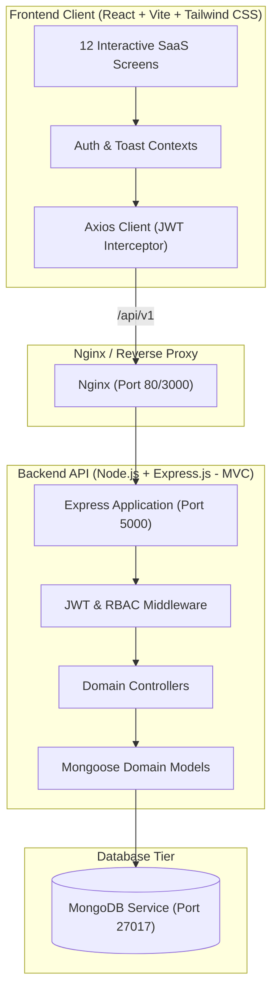

# Enterprise Customer Relationship Management (CRM) System for Small Businesses

A production-grade, full-stack Customer Relationship Management (CRM) web application designed for small and medium-sized businesses (SMBs). Built on the **MERN** stack (MongoDB, Express.js, React, Node.js) with Tailwind CSS, Vite, Docker, and Kubernetes orchestration.

---

## 1. Project Overview

Modern small businesses often struggle with fragmented communication, missed lead follow-ups, opaque sales pipelines, and scattered spreadsheets. This enterprise-quality CRM system centralizes sales, customer support, and operational workflows into a single high-performance platform.

### Key Highlights:
- **Strict Role-Based Access Control (RBAC)** across 4 distinct user tiers: Admin, Sales Manager, Sales Executive, and Customer Support.
- **12 Fully Functional Production Screens** (no mockups, no placeholders).
- **Kanban-Style Interactive Sales Pipeline** with live stage values and drag/advance progression.
- **Automated Lead-to-Customer Conversion** with duplicate detection and opportunity generation.
- **4 Mandatory Analytics Reports** using real-time MongoDB aggregation pipelines (no static or hardcoded chart data).
- **Enterprise DevOps Pipeline**: Multi-stage Dockerfiles, Docker Compose service topology, and full Kubernetes manifests (`k8s/`).

---

## 2. Problem Statement

Small businesses face significant operational hurdles when managing client lifecycles:
1. **Lead Leakage**: Leads acquired from websites, referrals, and campaigns go untracked or are lost in personal inboxes.
2. **Lack of Pipeline Visibility**: Leadership lacks insight into deal velocity, win rates, and expected monthly revenue.
3. **Inconsistent Customer History**: Support and sales representatives frequently contact clients without knowledge of previous calls, meetings, or open complaints.
4. **Weak Access Control**: Traditional small-business tools either grant full administrative rights to everyone or lack granular permissions.

---

## 3. Project Objectives

- Deliver an intuitive, modern SaaS user interface with instant responsiveness, loading skeletons, and interactive charts.
- Implement strict security and RBAC at both frontend routing and backend middleware levels.
- Eliminate data silos by linking customers, leads, opportunities, tasks, follow-ups, and interaction timelines.
- Guarantee full production deployability via Docker and local or cloud Kubernetes clusters.

---

## 4. Functional Requirements

### 1. Authentication & RBAC
- Secure JWT-based authentication with bcrypt password hashing (10 salt rounds).
- Automatic token expiration handling and session restoration.
- Single-click demo credential switcher for rapid evaluation across all 4 roles.

### 2. Customer Management
- Full CRUD operations with search, filtering by status (`active`, `inactive`, `lead`), and assigned employee.
- Detailed customer profiles displaying contact information, address, assigned sales rep, and linked deal contracts.
- Customer interaction history drawer.

### 3. Lead Management & Conversion
- Lead lifecycle tracking across 6 stages: `New`, `Contacted`, `Qualified`, `Proposal`, `Converted`, `Lost`.
- Automatic duplicate prevention by email and phone number.
- 1-click **Convert Lead to Customer** workflow: provisions customer record, flags lead as converted, and creates an associated opportunity.

### 4. Sales Pipeline (Kanban)
- Interactive board with stage columns, lead counts, and cumulative deal valuations.
- Quick stage advancer buttons and instant valuation updates.
- Real-time pipeline capitalization metric cards.

### 5. Follow-up Management
- Follow-up scheduler for Calls, Meetings, Demos, and Emails.
- Automated overdue status updates based on system clock.
- "Mark as Completed" modal recording outcome summaries.

### 6. Task Management
- Task assignment with priority levels (`Low`, `Medium`, `High`, `Urgent`) and due dates.
- Filter by status (`Pending`, `In Progress`, `Completed`) and employee.
- Quick checkbox toggle for immediate status completion.

### 7. Opportunities Management
- Deal stage progression: `Discovery`, `Proposal`, `Negotiation`, `Closed Won`, `Closed Lost`.
- Revenue forecasting, probability calculation, and won revenue recording.

### 8. Customer Interaction History
- Central chronological timeline tracking calls, meetings, emails, support tickets, and notes.
- Linked directly to customers or leads.

### 9. User Management (Admin Only)
- User provisioning, role assignment, active/inactive suspension toggle, and credential resets.
- Access denied protection for unauthorized roles.

### 10. Profile & Settings
- Personal profile editor (Name, Phone, Department, Avatar URL).
- Password change modal with current password verification.
- System environment metadata overview.

---

## 5. Non-Functional Requirements

- **Security**: JWT tokens in `Authorization: Bearer` headers, password hashing with bcrypt, input sanitization, and Mongoose schema validations.
- **Performance**: Vite-bundled React frontend (< 300ms HMR), indexing on frequently queried MongoDB fields (`status`, `email`, `assignedTo`, `createdAt`).
- **Scalability**: Decoupled 3-tier architecture capable of horizontal scaling behind Nginx or Kubernetes ingress controllers.
- **Reliability**: Centralized backend error-handling middleware preventing unhandled promise rejections or server crashes.
- **Responsiveness**: Mobile, tablet, and desktop layout optimization via Tailwind CSS.

---

## 6. Technology Stack

### Frontend
- **Framework**: React 18 with Vite
- **Styling**: Tailwind CSS
- **Routing**: React Router DOM (v6)
- **HTTP Client**: Axios with request/response interceptors
- **Data Visualization**: Recharts (Bar, Line, Pie, Area)
- **Icons**: Lucide React

### Backend
- **Runtime**: Node.js (v20+)
- **Framework**: Express.js
- **Architecture**: Modular MVC (Controllers, Routes, Middleware, Models, Config)
- **Authentication**: JSON Web Tokens (JWT) & bcryptjs
- **Logging & CORS**: Morgan & CORS

### Database
- **Primary**: MongoDB (Mongoose ODM v8)
- **Development Fallback**: Embedded `mongodb-memory-server` auto-fallback if local MongoDB server is not running.

### DevOps & Containerization
- **Docker**: Multi-stage production builds for backend and frontend
- **Docker Compose**: Service definitions for MongoDB, Backend, and Frontend (Nginx reverse proxy)
- **Kubernetes**: Manifests for Deployments, ClusterIP & NodePort Services, PVC, ConfigMaps, and Secrets.

---

## 7. System Architecture



---

## 8. Role-Based Access Control (RBAC) Matrix

| Feature / Screen | Admin | Sales Manager | Sales Executive | Customer Support |
| :--- | :---: | :---: | :---: | :---: |
| **Authentication & Profile** | Yes | Yes | Yes | Yes |
| **Executive Dashboard** | System-Wide | Team-Wide | Personal Stats | Support Focus |
| **Customer Management** | Full CRUD | Full CRUD | Create / Read / Edit | Read / Edit Notes |
| **Lead Management** | Full CRUD | Full CRUD | Assigned Only | Read-Only |
| **Sales Pipeline** | Full Access | Full Access | Assigned Deals | Read-Only |
| **Follow-up Management**| Full Access | Team Tracking | Assigned Follow-ups | Assigned Follow-ups |
| **Task Management** | Full CRUD | Team Tasks | Assigned Tasks | Assigned Tasks |
| **Opportunities** | Full CRUD | Pipeline Control | Assigned Ops | View Linked Ops |
| **Interaction History** | Full Access | Full Access | Log & View | Log & View |
| **Reports & Analytics** | All 4 Reports | Sales & Conversion | Personal Sales Stats | Activity Reports |
| **User Management** | Full CRUD | Forbidden | Forbidden | Forbidden |

---

## 9. Database Schema (Mongoose Models)

1. **User**: `name`, `email`, `password` (hashed), `role` (`admin`, `sales_manager`, `sales_executive`, `customer_support`), `department`, `phone`, `avatar`, `isActive`, `lastLogin`, `timestamps`.
2. **Customer**: `name`, `company`, `email`, `phone`, `address` (`street`, `city`, `state`, `zip`, `country`), `status` (`active`, `inactive`, `lead`), `source`, `industry`, `totalRevenue`, `assignedTo` (ref User), `notes`, `createdBy` (ref User), `timestamps`.
3. **Lead**: `title`, `name`, `company`, `email`, `phone`, `source`, `status` (`New`, `Contacted`, `Qualified`, `Proposal`, `Converted`, `Lost`), `priority`, `estimatedValue`, `assignedTo` (ref User), `convertedCustomerId` (ref Customer), `convertedAt`, `notes`, `timestamps`.
4. **Opportunity**: `title`, `customer` (ref Customer), `lead` (ref Lead), `value`, `stage` (`Discovery`, `Proposal`, `Negotiation`, `Closed Won`, `Closed Lost`), `probability`, `expectedCloseDate`, `actualCloseDate`, `assignedTo` (ref User), `notes`, `lostReason`, `timestamps`.
5. **FollowUp**: `title`, `type` (`Call`, `Meeting`, `Email`, `Demo`, `Other`), `scheduledDate`, `status` (`Pending`, `Completed`, `Cancelled`, `Overdue`), `priority`, `customer` (ref Customer), `lead` (ref Lead), `assignedTo` (ref User), `outcome`, `notes`, `timestamps`.
6. **Task**: `title`, `description`, `assignedTo` (ref User), `priority` (`Low`, `Medium`, `High`, `Urgent`), `status` (`Pending`, `In Progress`, `Completed`), `dueDate`, `relatedTo` (`modelType`, `refId`), `completedAt`, `timestamps`.
7. **Interaction**: `type` (`Call`, `Meeting`, `Email`, `Note`, `Support Ticket`), `subject`, `details`, `customer` (ref Customer), `lead` (ref Lead), `performedBy` (ref User), `date`, `durationMinutes`, `outcome`, `timestamps`.

---

## 10. The 4 Mandatory Reports

All reports use live MongoDB aggregation pipelines:
1. **Lead Conversion Report**: Funnel aggregation ($facet on stages, win/loss ratio, overall conversion rate %).
2. **Sales Performance Report**: Monthly revenue aggregation, rep performance ranking, average deal size, total won opportunities.
3. **Customer Details Report**: Customer segment breakdowns, acquisition timeline, status distribution, assigned rep volume.
4. **Follow-up Activity Report**: Status distribution (Completed, Pending, Overdue), employee compliance metrics, weekly velocity.

---

## 11. Installation & Local Execution

### Prerequisites
- Node.js v18 or higher
- npm v9 or higher
- MongoDB (optional; backend auto-launches embedded in-memory MongoDB if local instance is absent)

### Step 1: Clone Repository
```bash
git clone <repository-url>
cd CRM-system
```

### Step 2: Install Backend Dependencies
```bash
cd backend
npm install
```

### Step 3: Install Frontend Dependencies
```bash
cd ../frontend
npm install
```

### Step 4: Seed Database with Initial Data
The backend automatically executes the seeder on first boot if no users are detected. To manually re-seed at any time:
```bash
cd ../backend
npm run seed
```

### Step 5: Start Development Servers
**Backend Server (Port 5000):**
```bash
cd backend
npm run dev
# or: npm start
```

**Frontend Client (Port 3000):**
```bash
cd frontend
npm run dev
```

Open your browser at `http://localhost:3000`.

---

## 12. Default Demo Credentials

| Role | Email | Password |
| :--- | :--- | :--- |
| **Admin** | `admin@crmpro.com` | `Admin@123` |
| **Sales Manager** | `manager@crmpro.com` | `Manager@123` |
| **Sales Executive** | `executive@crmpro.com` | `Executive@123` |
| **Customer Support** | `support@crmpro.com` | `Support@123` |

*Note: The login screen also features quick 1-click credential selector buttons for effortless testing.*

---

## 13. Docker & Docker Compose Execution

Run the complete multi-container stack (Database, API, and Web UI) with a single command:

```bash
docker-compose up --build
```

- **Frontend**: `http://localhost:3000`
- **Backend API**: `http://localhost:5000/api/health`
- **MongoDB**: `localhost:27017`

To shut down and preserve data:
```bash
docker-compose down
```

To shut down and wipe persistent volumes:
```bash
docker-compose down -v
```

---

## 14. Kubernetes Deployment Instructions

All Kubernetes manifests are located in the `k8s/` folder.

### 1. Apply Secrets and ConfigMaps
```bash
kubectl apply -f k8s/secrets.yaml
kubectl apply -f k8s/configmap.yaml
```

### 2. Deploy MongoDB Persistent Storage & Pod
```bash
kubectl apply -f k8s/mongodb-deployment.yaml
```

### 3. Deploy Backend Microservice
```bash
kubectl apply -f k8s/backend-deployment.yaml
```

### 4. Deploy Frontend Web UI
```bash
kubectl apply -f k8s/frontend-deployment.yaml
```

### 5. Verify Pods and Services
```bash
kubectl get pods -l app.kubernetes.io/part-of=crm-system
kubectl get svc
```

### 6. Access Application in Kubernetes
Access the frontend on NodePort `30080`:
```bash
http://<minikube-ip-or-node-ip>:30080
```

---

## 15. API Documentation

### Authentication Endpoints
- `POST /api/v1/auth/login` - User login & JWT issuance
- `GET /api/v1/auth/me` - Current authenticated user
- `PUT /api/v1/auth/update-profile` - Update name, phone, department, avatar
- `PUT /api/v1/auth/change-password` - Password update

### Customer Endpoints
- `GET /api/v1/customers` - Filter, search, paginate customer records
- `GET /api/v1/customers/:id` - Customer profile + interactions + opportunities
- `POST /api/v1/customers` - Create customer
- `PUT /api/v1/customers/:id` - Update customer
- `DELETE /api/v1/customers/:id` - Delete customer (Admin/Manager)

### Lead Endpoints
- `GET /api/v1/leads` - List leads by stage, source, priority
- `POST /api/v1/leads` - Create lead (with duplicate detection)
- `PATCH /api/v1/leads/:id/stage` - Quick pipeline stage update
- `POST /api/v1/leads/:id/convert` - Convert qualified lead to customer
- `DELETE /api/v1/leads/:id` - Delete lead

### Sales Pipeline
- `GET /api/v1/pipeline` - Kanban board grouped columns with live valuations

### Follow-up & Task Endpoints
- `GET /api/v1/followups` - List follow-ups (overdue, pending, completed)
- `POST /api/v1/followups` - Schedule follow-up
- `PUT /api/v1/followups/:id` - Update or complete follow-up
- `GET /api/v1/tasks` - List tasks by status/priority/assignee
- `POST /api/v1/tasks` - Create task
- `PUT /api/v1/tasks/:id` - Update / toggle task completion

### Opportunities & Interactions
- `GET /api/v1/opportunities` - Opportunity tracking & forecasting
- `POST /api/v1/opportunities` - Create opportunity
- `PUT /api/v1/opportunities/:id` - Update stage (Closed Won/Lost)
- `GET /api/v1/interactions` - Chronological interaction timeline
- `POST /api/v1/interactions` - Log call, meeting, email, note, ticket

### Reports & Analytics
- `GET /api/v1/reports/lead-conversion` - Lead Conversion Report
- `GET /api/v1/reports/sales-performance` - Sales Performance Report
- `GET /api/v1/reports/customer-details` - Customer Details Report
- `GET /api/v1/reports/followup-activity` - Follow-up Activity Report

---

## 16. Security Standards Implemented

- **Password Hashing**: `bcryptjs` with salt round 10 before saving.
- **Stateless Tokens**: Signed JWTs with configurable expiration and tamper detection.
- **RBAC**: Middleware blocks unauthorized role access at the API route level.
- **Zero Secrets in Repository**: `.env.example` templates provided; real secrets managed via environment variables or Kubernetes secrets.
- **Sanitized Error Outputs**: Duplicate key and validation errors formatted cleanly without exposing database internals.

---

## 17. License

This project is licensed under the MIT License.

